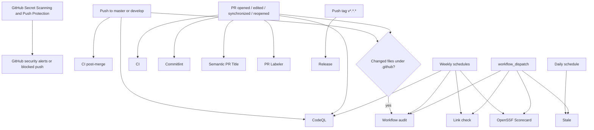
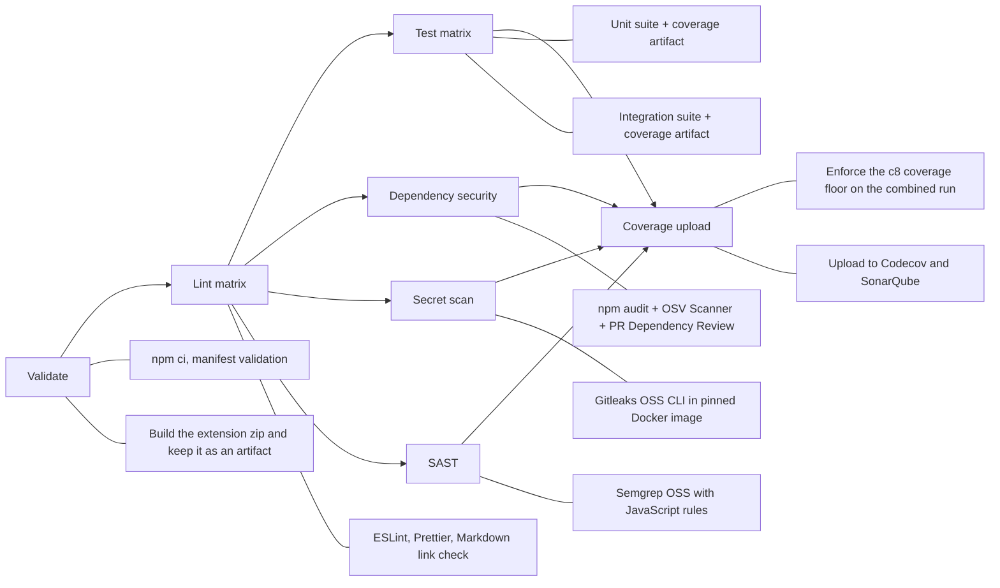
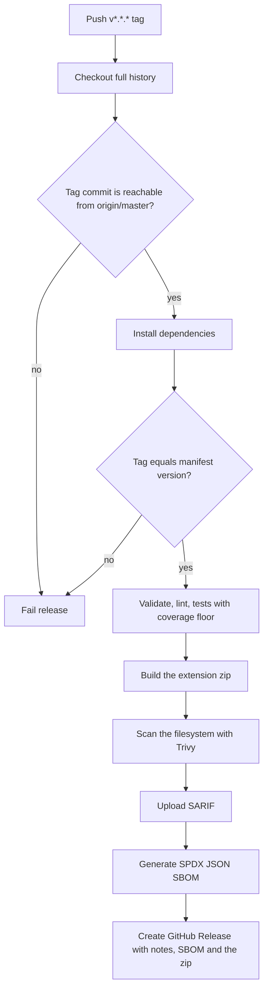

# GitHub Actions workflow flow

This document describes the workflows defined in `.github/workflows/`. All jobs run on GitHub-hosted `ubuntu-latest` runners with the Node.js version from `.nvmrc`.

## Overall event flow

## CI (`ci.yml`)

**Triggers:** pull request targeting `master` or `develop`. Concurrent runs for the same Git ref cancel older in-progress runs.

The required status checks for `master` and `develop` are the job names: `Validate`, `Lint (ESLint)`, `Lint (Prettier)`, `Lint (Docs)`, `Security (Dependencies)`, `Security (Secrets)`, `Security (SAST)`, `Test (Unit)`, `Test (Integration)` and `Coverage upload`.

## CI post-merge (`ci-post-merge.yml`)

**Triggers:** push to `master` or `develop`. Lighter sanity after a merge: validate, lint, tests with the coverage floor, Codecov and SonarQube.

## Release flow (`release.yml`)

**Trigger:** push of a tag matching `v*.*.*`. Runs are not cancelled.

The tag itself is the release trigger, and the `origin/master` ancestry gate stops a tag from publishing a commit that is not on the production branch.

## Other workflows

| Workflow             | Trigger                                                   | Flow / result                                                                                           |
| -------------------- | --------------------------------------------------------- | ------------------------------------------------------------------------------------------------------- |
| `codeql.yml`         | Push/PR on `master` or `develop`; Monday 06:00 UTC        | Initialize CodeQL for GitHub Actions and for JavaScript, analyze and publish the results.               |
| `commitlint.yml`     | PR opened, edited, synchronized, reopened                 | Checkout full history, validate every PR commit against `.github/commitlint.config.mjs`.                |
| `semantic-pr.yml`    | PR opened, edited, synchronized                           | Validate the PR title type and require an uppercase first subject character.                            |
| `pr-labeler.yml`     | PR opened, synchronized, reopened                         | Apply labels from `.github/labeler.yml` based on changed paths.                                         |
| `link-check.yml`     | Monday 04:00 UTC; manual                                  | Lychee checks Markdown links, excluding `node_modules`, Codecov and mail links.                         |
| `scorecard.yml`      | Push to `develop`; Monday 00:00 UTC; manual               | OpenSSF Scorecard, then upload SARIF.                                                                   |
| `stale.yml`          | Daily 01:00 UTC; manual                                   | Mark issues/PRs stale after 60 inactive days; close 14 days later, except pinned/security/dependencies. |
| `workflow-audit.yml` | `.github/**` changes on push/PR; Monday 03:00 UTC; manual | Actionlint checks workflow syntax; Zizmor scans workflow security and uploads SARIF.                    |

Dependabot (`.github/dependabot.yml`) opens weekly update PRs for npm and GitHub Actions; Actions are pinned by commit SHA.

## Scheduled maintenance timeline

All cron expressions use UTC, not the runner's local timezone.

```mermaid
gantt
    title Scheduled workflows (UTC)
    dateFormat  HH:mm
    axisFormat  %H:%M
    section Monday
    OpenSSF Scorecard      :milestone, 00:00, 0m
    Stale (also daily)     :milestone, 01:00, 0m
    Workflow audit         :milestone, 03:00, 0m
    Link check             :milestone, 04:00, 0m
    CodeQL                 :milestone, 06:00, 0m
```

## Notes

- All jobs use GitHub-hosted `ubuntu-latest`. The CLI's Edge integration is Windows-only and is not exercised in CI; the tests fake the browser.
- Secret scanning has two layers: GitHub Secret Scanning and Push Protection detect or block supported secrets at GitHub, while CI scans the checked-out Git history with the MIT-licensed Gitleaks OSS CLI. The GitHub layer is controlled in the repository security settings, not by a workflow file.
- The coverage job uploads the combined report to Codecov and SonarQube. It normalizes a scheme-less `SONAR_HOST_URL` to `https://…` before scanning.
- Secrets used: `CODECOV_TOKEN`, `SONAR_TOKEN` and optionally `SONAR_HOST_URL`.
